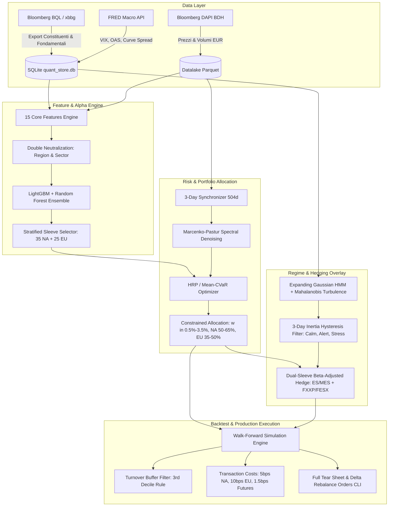

# Transatlantic Quant Portfolio — Asset Allocator

[](https://python.org)
[](https://github.com/astral-sh/uv)
[](https://github.com/astral-sh/ruff)
[](https://mypy-lang.org/)
[-brightgreen.svg)](tests/)

Sistema quantitativo end-to-end per la gestione e l'allocazione ottimale di un portafoglio azionario **Long-Only Transatlantico** (**USA + Canada + Europa**, *ex-Financials*), progettato per massimizzare il *Tail Risk Alpha* e mitigare i Drawdown severi tramite:

1. **Selezione Cross-Sectional Machine Learning:** Modello ensemble (LightGBM + Random Forest) su 10 fondamentali Point-in-Time e 5 feature tecniche/di rischio, con neutralizzazione doppia `(Region_Bloc, GICS_Sector)` e Purged Walk-Forward CV.
2. **Sincronizzazione Multi-Day e Denoising Spettrale RMT:** Resampling sincronizzato a 3 giorni lavorativi per eliminare il disallineamento dei fusi orari (17:30 CET vs 22:00 CET) e depurazione della matrice di covarianza con teoria di Marcenko-Pastur.
3. **Allocazione Topologica e Tail-Oriented:** Hierarchical Risk Parity (HRP) e Mean-CVaR ($\beta=0.95$) con proiezione convessa su vincoli realistici di singolo titolo ($0.5\% \le w_i \le 3.5\%$) e sleeve regionali (NA: $50-65\%$, EU: $35-50\%$).
4. **Dual-Sleeve Dynamic Hedging:** Copertura bipartita tramite contratti future su indici (`ES`/`MES` per Nord America, `FXXP`/`FESX` per Europa) guidata da sensori indipendenti HMM espansivi, Turbolenza di Mahalanobis e filtro di isteresi a 3 giorni.
5. **Simulatore Walk-Forward & Pipeline di Produzione:** Motore di contabilità giornaliera multi-valuta (EUR Base), modellazione dei costi di transazione (5 bps NA, 10 bps EU, 1.5 bps future), buffer di decile anti-turnover e distinta ordini per il ribilanciamento operativo.
6. **Backup Atomico e Dashboard Streamlit:** Backup a caldo transazionale (API nativa SQLite) con archiviazione Parquet/BQL compresso e retention policy, affiancato da dashboard interattiva di gestione e monitoraggio a 4 Tab.

---

## Struttura del Repository

```text
asset-allocator/
├── GEMINI.md                 # Specifiche architetturali e roadmap di sviluppo
├── README.md                 # Panoramica, architettura e guida CLI
├── pyproject.toml            # Definizione progetto e configurazione ruff / mypy / pytest
├── uv.lock                   # Lockfile deterministico delle dipendenze
├── data/
│   ├── raw_bql_exports/      # Drop-zone per export storici BQL Bloomberg
│   ├── db/
│   │   └── quant_store.db    # Database SQLite (universo PiT, fondamentali, serie macro)
│   ├── parquet/              # Datalake Parquet partizionato per anno (serie Total Return EUR)
│   └── backups/              # Archivi compressi .zip di backup atomico SQLite e Parquet
├── src/
│   └── quant_portfolio/
│       ├── config.py         # Configurazione tipizzata Pydantic e parametri di sistema
│       ├── cli.py            # Interfaccia a riga di comando (CLI) completa
│       ├── storage/          # Schema SQLite, store Parquet e backup manager transazionale
│       ├── ingestion/        # Generatore BQL, parser export, client FRED e xbbg delta
│       ├── features/         # Pipeline 15 feature core e normalizzazione Z-score
│       ├── alpha/            # Machine Learning, Purged CV e Stratified Sleeve Selector
│       ├── risk/             # Multi-Day synchronizer, Marcenko-Pastur, HRP e Mean-CVaR
│       ├── regime/           # Expanding HMM (NA/EU), Turbolenza Mahalanobis e Inertia Filter
│       ├── hedging/          # Motore Dual-Sleeve Beta-Adjusted Futures Overlay
│       ├── backtest/         # Motore Walk-Forward, costi, buffer turnover e reporting
│       └── dashboard/        # Dashboard interattiva Streamlit (4 Tab operativi e Plotly)
└── tests/                    # Suite completa di 131 test unitari e di integrazione (mock Bloomberg)
```

---

## Architettura del Sistema



---

## Installazione e Requisiti

Il framework richiede Python $\ge 3.12$ ed è gestito esclusivamente tramite [`uv`](https://github.com/astral-sh/uv).

```powershell
# Clona il repository
git clone https://github.com/makoponi/asset-allocator.git
cd asset-allocator

# Sincronizza l'ambiente virtuale e le dipendenze
uv sync

# Verifica l'integrità del sistema
uv run quant-portfolio status
```

---

## Guida ai Comandi CLI

L'interfaccia a riga di comando copre l'intero flusso operativo:

### 1. Ingestione Dati e Macro
```powershell
# Ingestione serie macro e credit spread da FRED (consumo quote Bloomberg: 0)
uv run quant-portfolio fetch-macro --start 2010-01-01

# Generazione formule e query BQL per estrazione constituenti e fondamentali da Excel/terminale
uv run quant-portfolio generate-bql --output data/bql_queries.txt

# Ingestione constituenti e fondamentali dai file drop-zone
uv run quant-portfolio ingest-universe --dir data/raw_bql_exports/
uv run quant-portfolio ingest-fundamentals --dir data/raw_bql_exports/
```

### 2. Feature Engineering & Machine Learning Alpha
```powershell
# Calcolo e neutralizzazione delle 15 feature core per una data di riferimento
uv run quant-portfolio compute-features --date 2024-06-28 --output data/features_20240628.parquet

# Addestramento e validazione Purged Walk-Forward CV (5 fold con embargo)
uv run quant-portfolio train-alpha --start 2015-01-01 --end 2024-06-28 --splits 5

# Scoring dell'universo e selezione candidati stratificati (35 NA + 25 EU)
uv run quant-portfolio rank-universe --date 2024-06-28 --output data/candidates_20240628.csv
```

### 3. Allocazione di Rischio (HRP / Mean-CVaR)
```powershell
# Allocazione con Hierarchical Risk Parity su covarianza depurata con Marcenko-Pastur
uv run quant-portfolio allocate --date 2024-06-28 --method hrp --output data/alloc_hrp.csv

# Allocazione con Mean-CVaR (beta = 0.95)
uv run quant-portfolio allocate --date 2024-06-28 --method cvar --output data/alloc_cvar.csv
```

### 4. Sensori di Regime & Overlay di Copertura
```powershell
# Ispezione probabilità HMM e stato filtrato con inerzia a 3 giorni
uv run quant-portfolio regime --date 2024-06-28

# Calcolo dimensionamento contratti future (ES/MES per NA, FXXP/FESX per EU)
uv run quant-portfolio hedge --date 2024-06-28 --portfolio-value 10000000 --allocations data/alloc_hrp.csv
```

### 5. Backtest Walk-Forward & Ribilanciamento di Produzione
```powershell
# Simulazione storica Walk-Forward 2015-2026 con costi e buffer turnover
uv run quant-portfolio backtest --start 2015-01-01 --end 2026-12-31 --capital 10000000 --method hrp --output-dir data/backtest/

# Ribilanciamento mensile operativo: calcolo ordini delta e overlay future
uv run quant-portfolio rebalance --date 2026-10-16 --capital 10000000 --method hrp --holdings current_portfolio.csv --output orders.csv
```

### 6. Backup Transazionale & Dashboard Streamlit
```powershell
# Esecuzione backup compresso atomico di SQLite DB e Parquet con rotazione
uv run quant-portfolio backup --keep 10 --dest-dir G:\CONS_INV\RISK_MANAGEMENT\Backup\

# Avvio dashboard interattiva Streamlit (4 Tab: Regime, Allocazione, Ribilanciamento, Backtest)
uv run quant-portfolio dashboard --port 8501
```

---

## Qualità del Codice e Testing

Il progetto applica i più rigorosi standard di ingegneria del software e quantitative finance:

```powershell
# Linting e formatting con ruff (max-line-length: 100)
uv run ruff check --fix src tests && uv run ruff format src tests

# Static type checking in modalità strict (nessun tipo implicito o Any non documentato)
uv run mypy --strict src tests

# Test suite completa (132 test deterministici, zero chiamate esterne di rete)
uv run pytest -v
```

---

## Licenza e Proprietà
Progetto sviluppato per il team di Risk Management & Finanza Quantitativa di **Consultinvest** (CONSULT PARTECIPAZIONI SPA). Tutti i diritti riservati.
